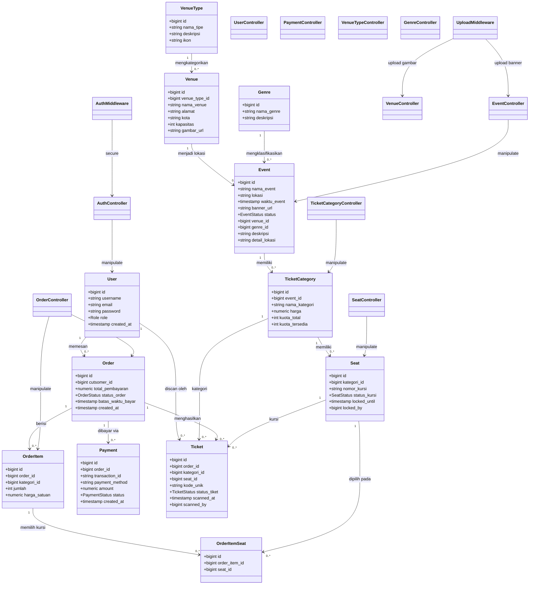
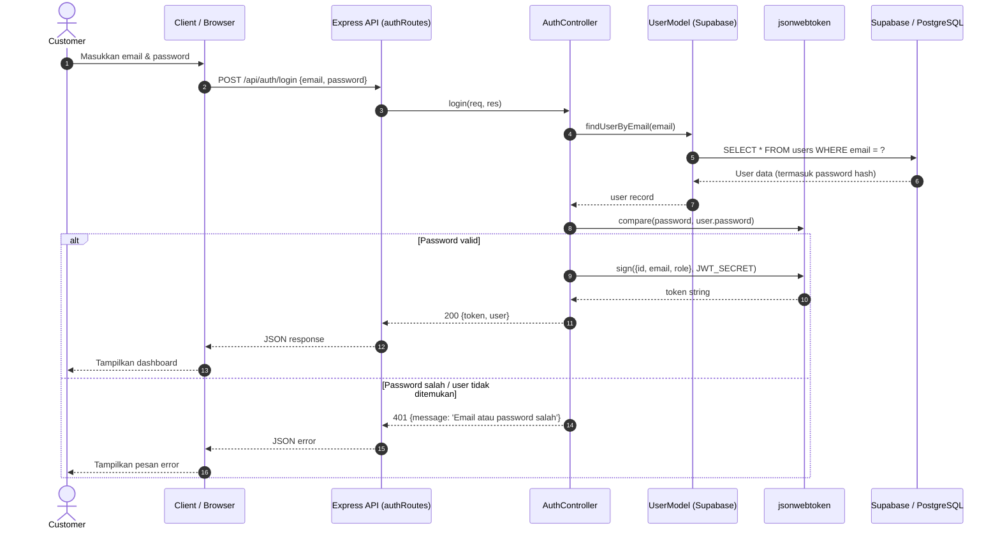
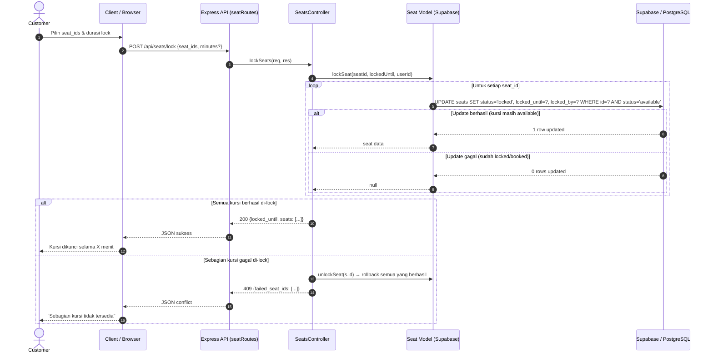

# 📐 UML Diagram — Sistem Pemesanan Tiket Konser

Dokumen ini berisi semua diagram UML untuk proyek backend **API Tiket Konser UKK** (Express + Supabase/PostgreSQL).

Diagram berikut tersedia:

1. [Class Diagram](#1-class-diagram)
2. [Sequence Diagram — Login](#2-sequence-diagram-login)
3. [Sequence Diagram — Seat Locking](#3-sequence-diagram-seat-locking)
4. [Sequence Diagram — Order Creation (Checkout)](#4-sequence-diagram-order-creation-checkout)
5. [Sequence Diagram — Order Payment](#5-sequence-diagram-order-payment)
6. [Activity Diagram — Order Checkout](#6-activity-diagram-order-checkout)
7. [Activity Diagram — Seat Locking](#7-activity-diagram-seat-locking)
8. [Use Case Diagram](#8-use-case-diagram)

---

## 1. Class Diagram



### Penjelasan Relasi Utama

| Entitas A | Kardinalitas | Entitas B | Keterangan |
|-----------|-------------|-----------|------------|
| `User` | 1 → 0..* | `Order` | Satu user bisa membuat banyak order |
| `VenueType` | 1 → 0..* | `Venue` | Satu tipe tempat bisa punya banyak venue |
| `Venue` | 1 → 0..* | `Event` | Satu venue bisa menjadi lokasi banyak event |
| `Genre` | 1 → 0..* | `Event` | Satu genre bisa mengklasifikasikan banyak event |
| `Event` | 1 → 0..* | `TicketCategory` | Satu event punya banyak kategori tiket |
| `TicketCategory` | 1 → 0..* | `Seat` | Satu kategori punya banyak kursi |
| `Order` | 1 → 0..* | `OrderItem` | Satu order berisi banyak item |
| `OrderItem` | 1 → 0..* | `OrderItemSeat` | Satu item memilih banyak kursi spesifik |
| `Seat` | 1 → 0..* | `OrderItemSeat` | Satu kursi hanya boleh di satu item order (UNIQUE) |

---

## 2. Sequence Diagram — Login



## 3. Sequence Diagram — Seat Locking



## 4. Sequence Diagram — Order Creation (Checkout)

```mermaid
sequenceDiagram
    autonumber
    actor Customer as Customer
    participant Client as Client / Browser
    participant API as Express API (orderRoutes)
    participant OrderCtrl as OrdersController
    participant OrderModel as Order Model (pg Pool)
    participant DB as PostgreSQL (Supabase)
    participant Trigger as DB Trigger: kurangi_kuota_tiket

    Customer->>Client: Kirim seat_ids yang sudah di-lock
    Client->>API: POST /api/orders {seat_ids: [...]}
    API->>OrderCtrl: createOrder(req, res)
    OrderCtrl->>OrderModel: createOrder({customer_id, seat_ids})

    OrderModel->>DB: BEGIN TRANSACTION
    OrderModel->>DB: SELECT seats WHERE id = ANY(seat_ids) FOR UPDATE
    DB-->>OrderModel: Rows seat (status_kursi, locked_by, locked_until)

    alt Beberapa kursi tidak locked / bukan milik user / expired
        OrderModel->>DB: ROLLBACK
        OrderModel-->>OrderCtrl: Error 409
        OrderCtrl-->>API: 409 {message}
        API-->>Client: JSON error
        Client-->>Customer: Gagal membuat order
    else Semua kursi valid & milik user
        OrderModel->>DB: INSERT INTO orders (cutsomer_id, status_order, batas_waktu_bayar)
        DB-->>OrderModel: Order baru (id)

        loop Group seats by kategori_id
            OrderModel->>DB: INSERT INTO order_items (order_id, kategori_id, jumlah, harga_satuan)
            DB->>Trigger: BEFORE INSERT order_items
            Trigger->>DB: SELECT kuota_tersedia FROM ticket_categories FOR UPDATE
            alt Kuota cukup
                Trigger->>DB: UPDATE ticket_categories SET kuota_tersedia = kuota_tersedia - jumlah
                DB-->>Trigger: OK
                DB-->>OrderModel: Item inserted
            else Kuota tidak cukup
                Trigger->>DB: RAISE EXCEPTION 'kuota tidak mencukupi'
                OrderModel->>DB: ROLLBACK
                OrderCtrl-->>API: 409 {message: 'kuota habis'}
                API-->>Client: JSON error
                Client-->>Customer: Gagal checkout
                return
            end

            OrderModel->>DB: INSERT INTO order_item_seats (order_item_id, seat_id)
        end

        OrderModel->>DB: COMMIT
        OrderModel-->>OrderCtrl: {order, items}
        OrderCtrl-->>API: 201 {order, items}
        API-->>Client: JSON sukses
        Client-->>Customer: Order created (pending, batas_waktu_bayar +15 menit)
    end
```

## 5. Sequence Diagram — Order Payment

```mermaid
sequenceDiagram
    autonumber
    actor Customer as Customer
    participant Client as Client / Browser
    participant API as Express API (orderRoutes)
    participant OrderCtrl as OrdersController
    participant OrderModel as Order Model (pg Pool)
    participant DB as PostgreSQL
    participant PaymentModel as Payment Model

    Customer->>Client: Klik tombol Bayar pada order pending
    Client->>API: POST /api/orders/:id/pay
    API->>OrderCtrl: payOrder(id, userId, role)
    OrderCtrl->>OrderModel: payOrder(id, userId, role)

    OrderModel->>DB: BEGIN TRANSACTION
    OrderModel->>DB: SELECT * FROM orders WHERE id = ?
    alt Order tidak ditemukan atau bukan milik user
        OrderModel->>DB: ROLLBACK
        OrderCtrl-->>API: 404 / 403
        API-->>Client: JSON error
        Client-->>Customer: Order tidak ditemukan / akses ditolak
        return
    else Status bukan pending
        OrderModel->>DB: ROLLBACK
        OrderCtrl-->>API: 409 {message: 'Hanya order pending yang dapat dibayar'}
        API-->>Client: JSON error
        Client-->>Customer: Order sudah dibayar/dibatalkan
        return
    end

    OrderModel->>DB: UPDATE orders SET status_order='paid' WHERE id = ?
    OrderModel->>DB: UPDATE seats SET status_kursi='booked', locked_until=NULL, locked_by=NULL FROM order_item_seats WHERE order_id=?
    OrderModel->>PaymentModel: INSERT INTO payments (order_id, payment_method, amount, status) VALUES (?, 'manual', ?, 'success')
    PaymentModel->>DB: INSERT payments
    DB-->>PaymentModel: Payment record

    OrderModel->>DB: COMMIT
    OrderCtrl-->>API: 200 {order: paid}
    API-->>Client: JSON sukses
    Client-->>Customer: Order dibayar, kursi menjadi booked
```

## 6. Activity Diagram — Order Checkout

```mermaid
activityDiagram
    start
    :Customer memilih seat_ids yang sudah di-lock;
    :POST /api/orders {seat_ids};

    :Validasi seat_ids tidak kosong;
    if (seat_ids kosong?) then (Ya)
        :Return 400 Bad Request;
        stop
    endif

    :BEGIN TRANSACTION;
    :SELECT seats FOR UPDATE;
    :Cek status_kursi='locked' & locked_by=user & locked_until>now;

    if (Semua kursi valid?) then (Tidak)
        :ROLLBACK;
        :Return 409 Conflict;
        stop
    endif

    :INSERT INTO orders (pending, batas_waktu_bayar = now + 15m);

    loop Untuk setiap kategori
        :INSERT INTO order_items;
        :Trigger kurangi_kuota_tiket (cek kuota & kurangi);
        :INSERT INTO order_item_seats (unique seat_id);
    end

    :COMMIT;
    :Return 201 {order, items};
    :Kursi tetap locked, kuota berkurang;
    stop
```

## 7. Activity Diagram — Seat Locking

```mermaid
activityDiagram
    start
    :Customer memilih seat_ids & durasi (max 60 menit);
    :POST /api/seats/lock {seat_ids, minutes};

    :Validasi input (array tidak kosong, minutes 1-60);
    if (Input invalid?) then (Ya)
        :Return 400 Bad Request;
        stop
    endif

    :hitung locked_until = now + minutes;

    loop Untuk setiap seat_id
        :UPDATE seats SET status='locked', locked_by=user WHERE id=? AND status='available';
        if (Update berhasil?) then (Tidak)
            tambah ke failed_seat_ids;
        endif
    end

    if (Ada failed_seat_ids?) then (Ya)
        :Rollback: unlock semua seat yang berhasil di-lock;
        :Return 409 {failed_seat_ids};
        stop
    endif

    :Return 200 {locked_until, seats};
    :Kursi berstatus locked selama X menit;
    stop
```

## 8. Use Case Diagram

```mermaid
graph TD
    Customer[👤 Customer]
    Admin[🛡️ Admin / SuperAdmin]
    Scanner[📟 Scanner]

    UC1[(Login / Register)]
    UC2[(Lihat Profil)]
    UC3[(Lihat Semua Event)]
    UC4[(Detail Event)]
    UC5[Buat Event]
    UC6[Edit Event]
    UC7[Hapus Event]
    UC8[(Lihat Venue)]
    UC9[Buat Venue]
    UC10[Edit Venue]
    UC11[Hapus Venue]
    UC12[(Lihat Venue Type)]
    UC13[Buat Venue Type]
    UC14[Hapus Venue Type]
    UC15[(Lihat Genre)]
    UC16[Buat Genre]
    UC17[Edit Genre]
    UC18[Hapus Genre]
    UC19[(Lihat Ticket Category)]
    UC20[Buat Ticket Category]
    UC21[Edit Ticket Category]
    UC22[Hapus Ticket Category]
    UC23[(Lihat Kursi per Kategori)]
    UC24[Generate Kursi]
    UC25[Lock Kursi]
    UC26[Unlock Kursi]
    UC27[Buat Order]
    UC28[(Lihat Order Milik Sendiri)]
    UC29[(Lihat Semua Order - Admin)]
    UC30[Detail Order]
    UC31[Batalkan Order]
    UC32[Bayar Order Manual]
    UC33[Midtrans Webhook]
    UC34[(Daftar User - Admin)]
    UC35[Edit User]
    UC36[Hapus User]

    Customer --> UC1
    Customer --> UC2
    Customer --> UC3
    Customer --> UC4
    Customer --> UC8
    Customer --> UC12
    Customer --> UC15
    Customer --> UC19
    Customer --> UC23
    Customer --> UC25
    Customer --> UC26
    Customer --> UC27
    Customer --> UC28
    Customer --> UC30
    Customer --> UC31
    Customer --> UC32

    Admin --> UC1
    Admin --> UC2
    Admin --> UC3
    Admin --> UC4
    Admin --> UC5
    Admin --> UC6
    Admin --> UC7
    Admin --> UC8
    Admin --> UC9
    Admin --> UC10
    Admin --> UC11
    Admin --> UC12
    Admin --> UC13
    Admin --> UC14
    Admin --> UC15
    Admin --> UC16
    Admin --> UC17
    Admin --> UC18
    Admin --> UC19
    Admin --> UC20
    Admin --> UC21
    Admin --> UC22
    Admin --> UC23
    Admin --> UC24
    Admin --> UC25
    Admin --> UC26
    Admin --> UC27
    Admin --> UC29
    Admin --> UC30
    Admin --> UC31
    Admin --> UC32
    Admin --> UC34
    Admin --> UC35
    Admin --> UC36

    Scanner --> UC3
    Scanner --> UC4
```


